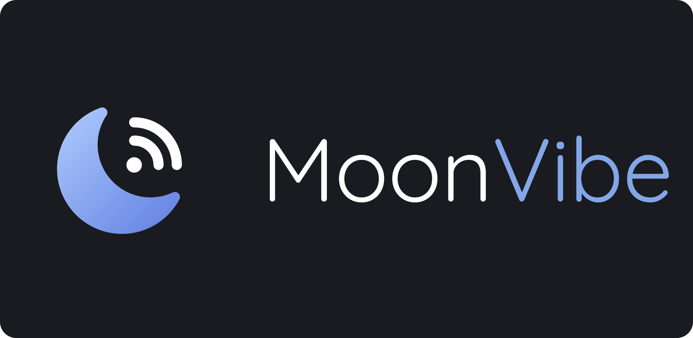
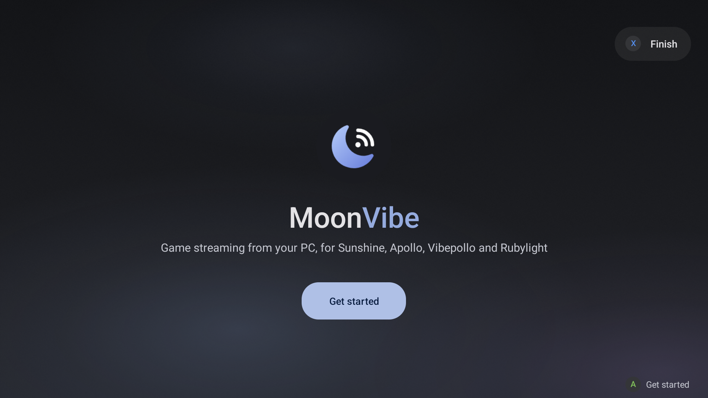
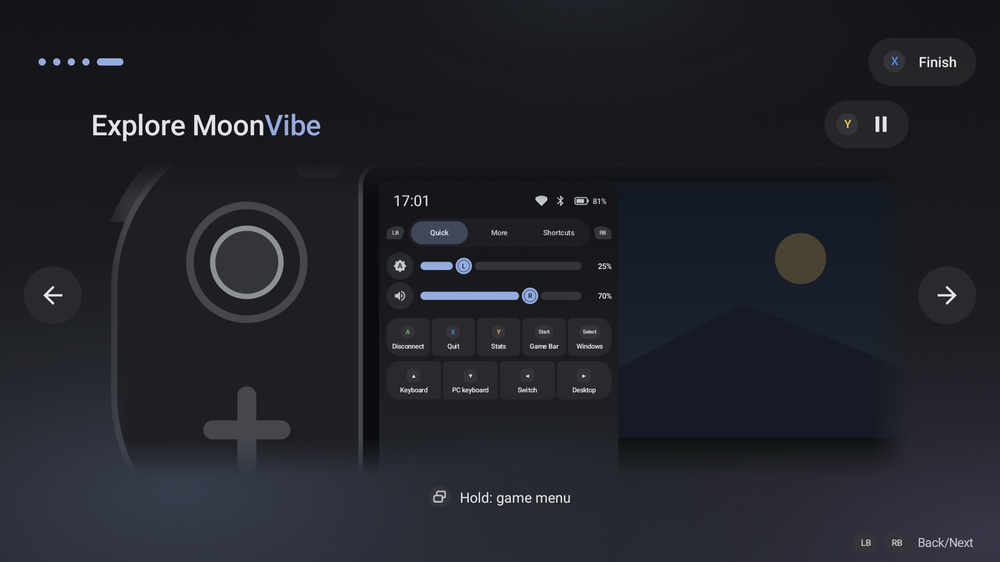
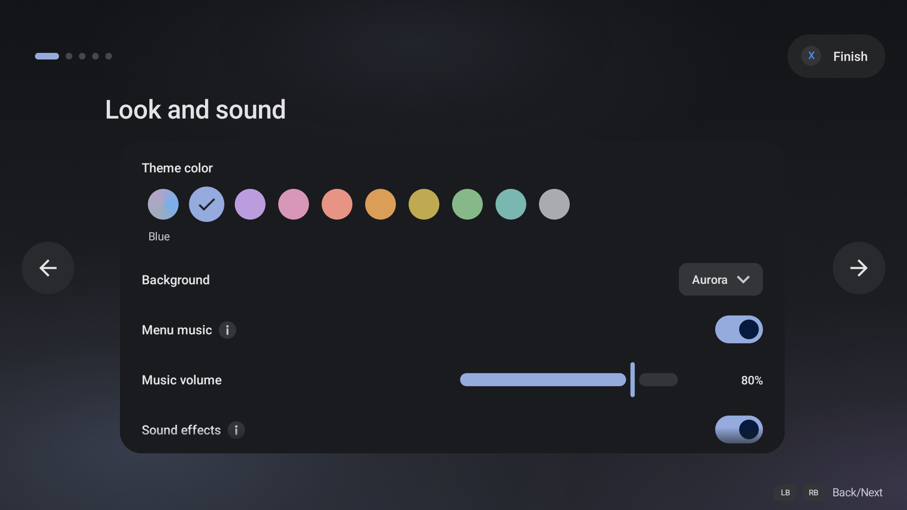
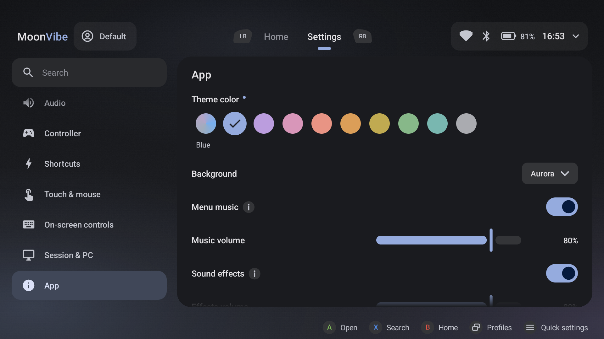

  

MoonVibe is an Android client for game streaming from your PC with [Sunshine](https://github.com/LizardByte/Sunshine), [Apollo](https://github.com/ClassicOldSong/Apollo), [Vibepollo](https://github.com/Nonary/Vibepollo) and [Rubylight](https://github.com/RamazanKara/Rubylight).

MoonVibe is built on [Moonlight for Android](https://github.com/moonlight-stream/moonlight-android) and brings in the best features of other Moonlight versions, such as [MoreOrLess](https://github.com/MoreOrLessSoftware/moonlight-android), [Artemis](https://github.com/ClassicOldSong/moonlight-android) and [Rubylight](https://github.com/RamazanKara/rubylight-android). On top of that, the whole user experience is reworked: a new interface, simpler navigation, and full support for both touch and gamepad.

> [!WARNING]
> MoonVibe is experimental: expect bugs and changes between releases.

## What you get

**A reworked user experience**
- New Material 3 interface: a dark design with animations, rebuilt for the home screen, the game library and the settings.
- Every screen works with your finger or a controller. LB/RB switch tabs, and button hints show while you use a gamepad.
- A first-run setup that connects your PC, tests the network, picks the stream quality and shows you around.
- Theme colors, animated backgrounds, menu music and sound effects.
- A unified in-game menu: quick actions, stream options, brightness, volume and the bitrate while streaming.
- Profiles, quick settings and a redesigned stats overlay.

**Streaming**
- The Vulkan renderer with PyroWave support and AMD FidelityFX CAS sharpening.
- Change the bitrate during the stream on Vibepollo and Rubylight, and see the host CPU and GPU in the stats on Rubylight.
- A full PC keyboard on screen, touchscreen modes (multi-touch, mouse, trackpad) and configurable 3/4/5-finger taps.

## Screenshots

  
  
  
  

## Download

Get the APK from the [releases](https://github.com/RickyTr99/moonvibe/releases).

## Building

- Install Android Studio and the Android NDK.
- Run `git submodule update --init --recursive` from the project folder.
- Build the APK with Android Studio or Gradle (`gradlew assembleNonRootDebug`).

The project path must not contain spaces, because `ndk-build` fails on them.

## Credits

- [Moonlight for Android](https://github.com/moonlight-stream/moonlight-android) by [Cameron Gutman](https://github.com/cgutman) and contributors
- [MoreOrLess](https://github.com/MoreOrLessSoftware/moonlight-android) by MoreOrLessSoftware: the source of the Vulkan renderer, PyroWave support, the frame pacing and many other features
- [Artemis](https://github.com/ClassicOldSong/moonlight-android) by ClassicOldSong: the source of the game menu, touch gestures, keyboard features and more
- [Rubylight](https://github.com/RamazanKara/rubylight-android) by RamazanKara: the idea behind the bitrate during the stream and the host readings in the stats
- [AMD FidelityFX CAS](https://github.com/GPUOpen-Effects/FidelityFX-CAS) (MIT): the sharpening filter

## License

GPL-3.0, like Moonlight. See [LICENSE.txt](LICENSE.txt).
